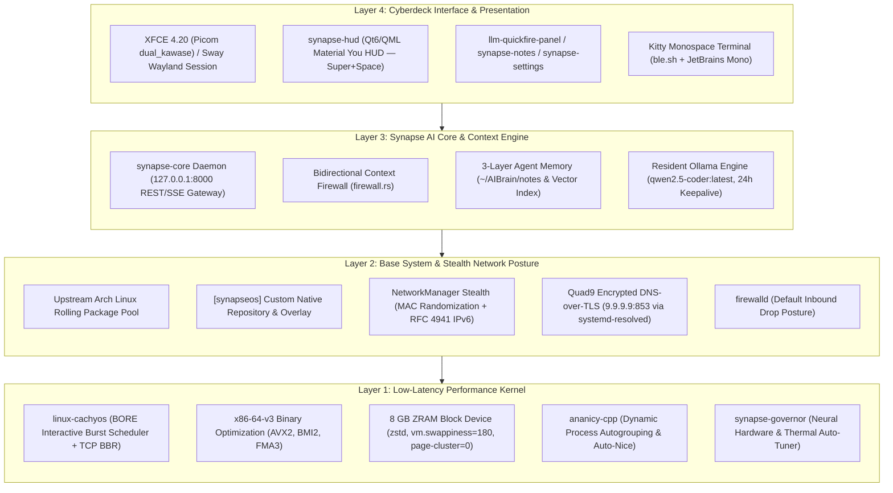
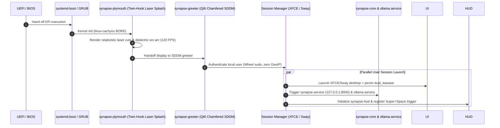

# SynapseOS

> **An AI-Native Rolling Linux Distribution**  
> *Surgical precision. Zero friction. One Brain. All Models.*
>
> *"System aims for minimal if not 0 telemetry and prioritises anonymisation without degradation of service."*

<p align="center">
  
</p>

<p align="center">
  <a href="https://github.com/earnerbaymalay/synapseOS/actions/workflows/build-iso.yml"></a>
  <a href="build/verify-gates.sh"></a>
  <a href="https://github.com/earnerbaymalay/synapseOS/releases"></a>
  
  
  
  
  
</p>

---

## ✨ What is SynapseOS? (The Plain-English Pitch)

Most operating systems treat AI as a cloud subscription designed to harvest your data, while bombarding your desktop with advertisements, background telemetry, and forced updates that slow your computer down.

**SynapseOS is different.**

SynapseOS is a complete, modern operating system designed from scratch for the AI era. It turns your laptop or desktop into an intelligent, private workstation:
- 🧠 **Your AI Lives on Your Machine**: Press **`Super + Space`** anywhere to summon your local AI assistant. Ask questions, draft documents, analyze code, or take notes. It runs **100% locally on your computer**—never uploads your keystrokes to the cloud, requires zero subscriptions, and works even when you're completely offline on an airplane.
- 🛡️ **Zero Spying, Zero Tracking (The Prime Directive)**: No corporate telemetry, no analytics beacons, no tracking IDs, and no ads in your search bar. Even your Wi-Fi address is randomized automatically so public networks cannot track your movements.
- ⚡ **Breathtaking Speed**: Built on low-latency kernels and high-efficiency memory compression, SynapseOS feels instantaneous. Apps launch immediately, animations glide at your monitor's full refresh rate, and older laptops feel brand new.
- 🎨 **Drop-Dead Gorgeous Cyberdeck Design**: Thoughtfully crafted with dark glass accents, liquid metal styling, custom themes, and natural neural voice streaming.
- 🛡️ **Unbreakable Updates (Time Machine Snapshots)**: Never fear an update again. SynapseOS automatically captures a system snapshot before any changes. If anything ever goes wrong, you can turn back the clock to a working state in 5 seconds.

---

## 🪟 Thinking of Switching from Windows or macOS?

If you've never used Linux before or found other distributions intimidating, **you are in the right place**. SynapseOS is engineered to give you all the power and privacy of Linux without the headaches:

```
┌────────────────────────────────────────────────────────────────────────┐
│               "DO I HAVE TO BE A LINUX HACKER TO USE THIS?"            │
│  No! You can do everything with a mouse, keyboard, and gorgeous apps.   │
│  The terminal is always there when you want it, but never forced.      │
└────────────────────────────────────────────────────────────────────────┘
```

### Quick Myth-Busters for Newcomers:
| Question | What It's Really Like on SynapseOS |
| :--- | :--- |
| **"Will I lose all my Windows files?"** | **No.** You can install SynapseOS **alongside Windows** (dual-boot). Every time you turn on your PC, you simply choose whether you want to boot into Windows or SynapseOS. |
| **"Can I test it before changing anything?"** | **Yes!** You can boot SynapseOS directly from a USB stick in **Live Mode**. It runs entirely in memory without touching your hard drive. Play with it, test your Wi-Fi, audio, and AI, and unplug it when you're done. |
| **"How do I install apps?"** | Forget hunting down `.exe` or `.dmg` files on sketchy websites. SynapseOS gives you access to a safe, verified repository with thousands of popular apps—including **Google Chrome / Chromium, VS Code, Spotify, Steam, Discord, OBS, VLC**, and more—installable with one click. |
| **"Do I need an expensive AI GPU?"** | **No.** SynapseOS is heavily optimized with AVX2 CPU acceleration and intelligent thermal management. Standard laptop processors (Intel Core i5/i7/i9, AMD Ryzen) run local models smoothly. |
| **"What's the 'Super' key everyone talks about?"** | The **Super** key is simply the **`Windows`** key on a PC keyboard or the **`Command`** key on a Mac. In SynapseOS, pressing `Super` is your primary superpower! |

---

## 🚀 Get Started in 3 Steps

You can test SynapseOS on almost any PC or laptop (Dell, Lenovo ThinkPad, Framework, HP, ASUS, Acer, or custom desktops) in under 10 minutes:

### 1. Download & Prepare a USB Drive
We recommend using **[Ventoy](https://www.ventoy.net)**, a free open-source tool that turns any USB flash drive into a multi-boot disk:
1. Install Ventoy onto your USB drive (one-click installer on Windows or Linux).
2. Download the latest `synapseos-x86_64.iso` from our [Releases](https://github.com/earnerbaymalay/synapseOS/releases).
3. Drag and drop the `.iso` file straight onto your USB drive! That's it—no complicated burning tools needed.

📖 **Step-by-step flashing guide with screenshots:**  
➡️ [**docs/VENTOY_BOOT_GUIDE.md**](docs/VENTOY_BOOT_GUIDE.md)

### 2. Plug In & Boot
1. Plug the USB drive into your computer and turn it on.
2. Immediately tap your computer's boot menu key (**`F12`** on Dell, Lenovo, and Framework; **`F9`** on HP; **`F8`** on ASUS).
3. Select your USB drive, choose **SynapseOS**, and hit Enter.

### 3. Explore or Install
You are now in the live environment!
- Tap **`Super + Space`** to open the **Synapse Command HUD** and chat with your local AI.
- Test your Wi-Fi, sound, and web browser.
- When you're ready to make it permanent, double-click the **Install SynapseOS** icon on your desktop to launch the friendly Calamares installer (choose whether to replace your drive or install alongside Windows).

📖 **Dual-boot preparation, Windows BitLocker suspension, & partitioning:**  
➡️ [**docs/DUAL_BOOT_AND_HARDWARE.md**](docs/DUAL_BOOT_AND_HARDWARE.md)

---

## ⌨️ Essential Keyboard Shortcuts

SynapseOS is designed for seamless flow. Memorize just three shortcuts to master your workstation:

| Shortcut | What It Does | Why You'll Love It |
| :--- | :--- | :--- |
| **`Super + Space`** | **Open Synapse HUD** | Your central command deck. Launch apps, ask your AI questions, search files, and trigger shortcuts instantly. |
| **`Super + Return`** | **Open Terminal** | Ultra-crisp, hardware-accelerated Kitty terminal with syntax highlighting and auto-suggestions. |
| **`Super + Ctrl + T`** | **Cycle Themes & Accents** | Instantly switch between Liquid Chrome, Monolith Mauve, Sapphire, Tungsten, and Emerald styling. |
| **`Super + /`** | **Shortcut Cheat Sheet** | Can't remember a key? Tap this to bring up an interactive on-screen cheat sheet anytime. |
| **`Super + i`** | **Launch System Installer** | Opens the guided graphical installer whenever you're ready to install to your drive. |
| **`Super + Alt + S`** | **Read Aloud (Neural Voice)** | Has your local AI read the latest answer or selected text aloud via natural human speech. |

---

## 💻 Supported Hardware

SynapseOS runs on any standard 64-bit (`x86_64`) computer built in the last decade:

| Tier | Category | Example Models | Experience |
| :--- | :--- | :--- | :--- |
| **Tier 0: Reference** | Official Engineering Hardware | **Dell Latitude 7490** (Intel 8th-Gen, UHD 620, 16–32 GB RAM) | **100% Certified** with custom 25W sustained thermal governor and zero-latency audio tuning. |
| **Tier 1: Certified** | Premium Laptops | **ThinkPad T14 / T480 / X1 Carbon**, **Framework Laptop 13 & 16**, AMD Ryzen 5000–8000 series, Intel 11th–14th Gen | **Flawless Out-of-the-Box**: Wi-Fi, Bluetooth, trackpad gestures, sleep/wake, and display scaling work automatically. |
| **Tier 2: Universal** | Any Modern PC | Custom gaming desktops, ASUS ROG / ZenBook, HP Spectre, Acer Swift, Intel/AMD/NVIDIA | **Full Performance**: Utilizes AVX2 CPU acceleration and automatic Vulkan graphics rendering. |

SynapseOS also includes an automatic hardware manager:
```bash
# Check your CPU temps, battery, and AI performance status:
synapse-hardware status
```

📖 **Detailed hardware matrix, power profiles, and GPU notes:**  
➡️ [**docs/HARDWARE_COMPATIBILITY.md**](docs/HARDWARE_COMPATIBILITY.md)

---

## 📦 Release Channels: Choose Your Pace

SynapseOS is available in three release channels depending on your needs:

- 🟢 **Stable Channel (`main`)**: Thoroughly tested and verified across all 279 engineering quality gates. Recommended for daily work, laptops, and primary PCs.
- 🟡 **Canary / Dev (`canary`)**: Updated bi-weekly with the newest experimental features and kernel enhancements. Great for enthusiasts who want the latest improvements early.
- 🟣 **Nightly (`staging-ci`)**: Continuously built from source code commits for automated testing.

📖 **Switching channels and configuring package mirrors:**  
➡️ [**docs/RELEASE_CHANNELS.md**](docs/RELEASE_CHANNELS.md)

---

<details>
<summary><h2>⚙️ Under the Hood: Deep Architecture & Technical Specs (Click to Expand)</h2></summary>

For developers, system architects, and Linux power users, here is the complete technical blueprint behind SynapseOS:

### The Five Architectural Pillars

1. **CachyOS Performance & Schedulers**: Deploys `linux-cachyos` with the **BORE (Burst-Oriented Response Enhancer)** scheduler, `x86-64-v3` AVX2 instruction optimizations, aggressive ZRAM `zstd` memory compression (`vm.swappiness=180`, `page-cluster=0`), TCP BBR congestion control, and `ananicy-cpp` dynamic process auto-nicing.
2. **Arch Linux & EndeavourOS Rolling Foundation**: Pure upstream rolling release base with clean PKGBUILD recipes, native systemd service isolation, and Calamares installer supporting Btrfs `@` subvolumes with automated `snapper` rollbacks.
3. **Cyberdeck Desktop & Monolithic Aesthetics**: Monospace terminal-first workflow, Qt6 chamfered SDDM login greeter (`synapse-greeter`), animated border light trails, Picom `dual_kawase` background blur, Catppuccin Mocha Mauve + Liquid Silver Chrome palettes, dual compositors (XFCE 4.20 and Sway Wayland), 4 metallic vector icon suites, and the laser-engraved Plymouth boot splash (`synapse-plymouth`).
4. **Synapse AI Core & Context Firewall**: Deeply integrated native `synapse-core` loopback gateway (`127.0.0.1:8000`), bidirectional context firewall (outbound token masking of MACs, private IPs, and keys with inbound rehydration), local resident Ollama models (`qwen2.5-coder:latest`), lossless token squasher (`/usr/bin/squash`), and persistent 3-layer vector memory.
5. **Prime Directive (Zero Telemetry & Anonymization)**: Strict hardware MAC address randomization on scanning and per-session links, RFC 4941 IPv6 privacy extensions, encrypted Quad9 DNS-over-TLS (`9.9.9.9:853`), hardened zero-telemetry Chromium, and firewalld default-drop posture:
   > *"System aims for minimal if not 0 telemetry and prioritises anonymisation without degradation of service."*

### Subsystem Hierarchy & Inter-Process Communication


### Monolithic Boot Kinematics Sequence


### Real-Time Hardware & Thermal Governor (`synapse-governor`)
SynapseOS runs a dedicated neural governor daemon (`synapse-governor.service`) that interfaces with `/sys/devices/system/cpu`:
- Continuously inspects CPU inference loads from Ollama and local LLM engines.
- Elevates CPU Energy Performance Preference (EPP) to `performance` during model generation, unlocking sustained 25W PL1 operation.
- Steps down to `balance_power` after 10 seconds of idle, saving battery life and keeping your chassis cool and quiet.

### Engineering Verification Gates (279/279 Passing)
Every commit and ISO image is subjected to strict automated verification across four quality gates in [`build/verify-gates.sh`](build/verify-gates.sh):
- **Gate G1**: Arch Linux PKGBUILD syntax, checksum validity, and packaging integrity.
- **Gate G2**: Kernel sysctl tuning, BORE scheduler parameters, ZRAM zstd swappiness, and stealth networking rules.
- **Gate G3**: UI themes, picom blur configurations, SDDM greeter QML compliance, and Sway hotkey collision audits.
- **Gate G4**: Calamares installer configuration, Btrfs subvolume layout (`@` and `@snapshots`), and security compliance.

</details>

---

## ❓ Frequently Asked Questions

### What makes SynapseOS different from standard Arch, EndeavourOS, or CachyOS?
> SynapseOS combines the best attributes of all three while adding a dedicated local AI architecture:
> - From **CachyOS**, it inherits the BORE low-latency kernel and `x86-64-v3` microarchitecture packages.
> - From **EndeavourOS**, it inherits a clean Arch base, native systemd service isolation, and Calamares.
> - On top of both, SynapseOS introduces **Synapse AI Core** (`synapse-core`), an offline-first **Bidirectional Context Firewall** on port 8000, 3-layer persistent agent memory, lossless token compression (`squash`), and strict **Prime Directive** zero-telemetry anonymization.

### Can I run AI completely offline without internet connectivity?
> **Yes.** Local models (such as `qwen2.5-coder:latest`) reside on disk in `/usr/share/ollama/.ollama/models`. All inference executes locally on CPU/Vulkan GPU via Ollama with 24h memory keepalive. Outbound requests through `synapse-core` undergo strict entropy inspection, ensuring zero prompt or credential leakage.

### How does the automated snapshot rollback work?
> Before any package update is written via `pacman -Syu`, `snap-pac` captures a Btrfs snapshot into `/.snapshots`. If a regression occurs, simply select **SynapseOS Snapshots** from the GRUB boot menu or run `sudo snapper rollback` from the terminal to instantly revert the system state.

📖 **Read the full Technical FAQ covering networking, sysctl, and audio:**  
➡️ [**docs/TECHNICAL_FAQ.md**](docs/TECHNICAL_FAQ.md)

---

## 🗺️ Roadmap & Future Phases

```
Phase 1–8 (Complete)  ──►  Phase 9 (In Progress)  ──►  Phase 10 (Q2 2027)  ──►  Phase 11–12
Live ISO & Hardware        Thermal Governor & eBPF    Distributed Agent Swarm    Immutable & CAD Kit
```

- [x] **Phase 1–5**: Core daemons, BORE kernel, cyberdeck styling, live archiso profile, Calamares Btrfs.
- [x] **Phase 6–7**: V4 visual identity, laser Plymouth boot splash, Material You HUD ecosystem, token squasher.
- [x] **Phase 8**: Clean 2.9 GB ISO compilation, `synapse-hardware` CLI orchestration, 279/279 engineering gate verification, release `v0.1.0-alpha.2`.
- [x] **Phase 9.1**: Dynamic PL1/PL2 CPU thermal and neural governor (`synapse-governor`).
- [ ] **Phase 9.2 (Q1 2027)**: Kernel-level eBPF secret leak interceptor and Vulkan compute offloading.
- [ ] **Phase 10 (Q2 2027)**: Peer-to-peer encrypted WireGuard/Libp2p brain synchronization and LAN inference offloading.
- [ ] **Phase 11**: Optional Ostree / Composefs read-only immutable root filesystem mode.
- [ ] **Phase 12**: Open-source CAD cyberdeck chassis hardware specifications.

📖 **Inspect the complete milestone history:**  
➡️ [**ROADMAP.md**](ROADMAP.md)

---

## 📂 Repository File Tree

```
synapseOS/
├── .github/workflows/       # CI/CD ISO build & Gate G1-G4 verification pipeline
│   └── build-iso.yml
├── docs/                    # Technical whitepapers & installation manuals
│   ├── VENTOY_BOOT_GUIDE.md
│   ├── DUAL_BOOT_AND_HARDWARE.md
│   ├── HARDWARE_COMPATIBILITY.md
│   ├── TECHNICAL_FAQ.md
│   ├── RELEASE_CHANNELS.md
│   └── ARCHITECTURE.md
├── build/                   # Archiso live image profile & verification tooling
│   ├── archiso/             # Profiledef, package manifest, pacman.conf, bootloaders & airootfs
│   ├── build-iso.sh         # Automated ISO build & overlay staging script
│   └── verify-gates.sh      # Gate G1-G4 verification test harness (279/279 checks)
├── packages/                # Native Arch Linux PKGBUILD recipes & installer configs
│   ├── core/synapse-core/   # PKGBUILD for Synapse runtime gateway & systemd units
│   ├── desktop/             # llm-quickfire-panel, synapse-hud, synapse-themes & synapse-greeter
│   └── installer/calamares/ # Calamares settings, Catppuccin branding & Btrfs modules
├── overlay/                 # Root filesystem overlays (/etc, sysctl, NetworkManager, skel)
├── out/                     # Compiled ISO artifacts, repo databases & cryptographic checksums
├── AGENTS.md                # System instructions & Prime Directive
├── ROADMAP.md               # Completed & upcoming implementation milestones
└── README.md                # Primary repository documentation
```

---

## 📜 License

SynapseOS is open-source software licensed under the **MIT License** and **GNU General Public License v3.0**.  
See [`LICENSE`](LICENSE) for full details.
