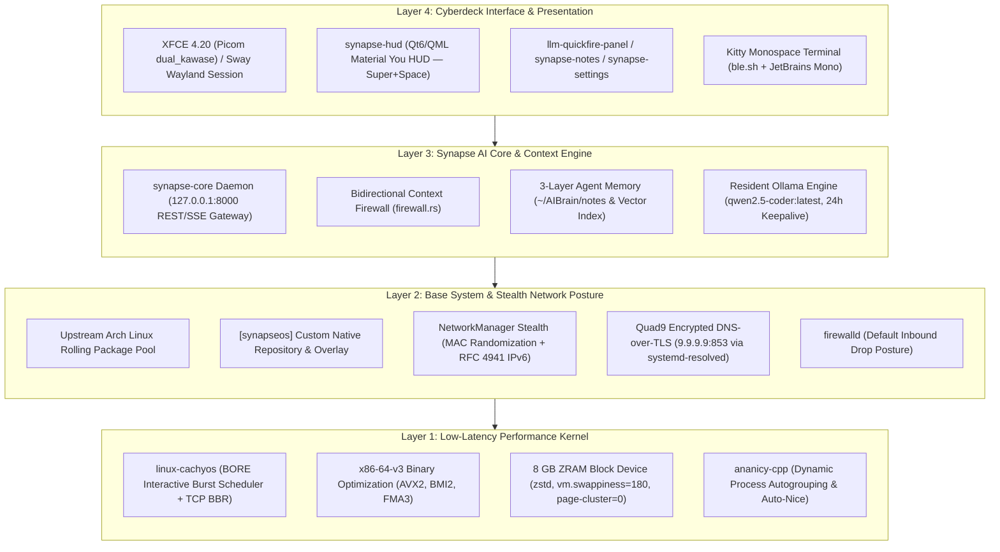
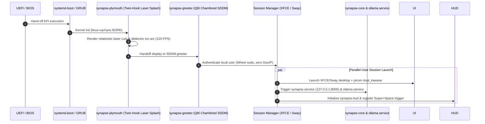

# SynapseOS
> **An AI-Native Rolling Linux Distribution**  
> *Surgical precision. Zero friction. One Brain. All Models.*
>
> *"System aims for minimal if not 0 telemetry and prioritises anonymisation without degradation of service."*

<p align="center">
  
</p>

<p align="center">
  <a href="https://github.com/earnerbaymalay/synapseOS/actions/workflows/build-iso.yml"></a>
  <a href="build/verify-gates.sh"></a>
  <a href="https://github.com/earnerbaymalay/synapseOS/releases"></a>
  
  
  
  
  
</p>
```
---

## ⚡ The Five Architectural Pillars

SynapseOS unites five core disciplines into one deterministic operating system:

1. **CachyOS Performance & Schedulers**: Deploys `linux-cachyos` with the **BORE (Burst-Oriented Response Enhancer)** scheduler, `x86-64-v3` AVX2 instruction optimizations, aggressive ZRAM `zstd` memory compression (`vm.swappiness=180`, `page-cluster=0`), TCP BBR congestion control, and `ananicy-cpp` dynamic process auto-nicing.
2. **EndeavourOS / Arch Rolling Foundation**: Clean upstream Arch Linux rolling package tree with transparent Arch Linux PKGBUILD recipes, native systemd service isolation, and Calamares installer supporting Btrfs `@` subvolumes with automated `snapper` rollbacks.
3. **Cyberdeck Desktop & Monolithic Aesthetics**: Monospace terminal-first workflow, Qt6 chamfered SDDM login greeter (`synapse-greeter`), animated border light trails, Picom `dual_kawase` background blur, Catppuccin Mocha Mauve + Liquid Silver Chrome palettes, dual compositors (XFCE 4.20 and Sway Wayland), 4 metallic vector icon suites, and the laser-engraved Plymouth boot splash (`synapse-plymouth`).
4. **Synapse AI Core & Context Firewall**: Deeply integrated native `synapse-core` loopback gateway (`127.0.0.1:8000`), bidirectional context firewall (outbound token masking of MACs, private IPs, and keys with inbound rehydration), local resident Ollama models (`qwen2.5-coder:latest`), lossless token squasher (`/usr/bin/squash`), and persistent 3-layer vector memory.
5. **Prime Directive (Zero Telemetry & Anonymization)**: Strict hardware MAC address randomization on scanning and per-session links, RFC 4941 IPv6 privacy extensions, encrypted Quad9 DNS-over-TLS (`9.9.9.9:853`), hardened zero-telemetry Chromium, and firewalld default-drop posture:
   > *"System aims for minimal if not 0 telemetry and prioritises anonymisation without degradation of service."*

---

## 🏗️ System Architecture

### Subsystem Hierarchy & Inter-Process Communication


### Monolithic Boot Kinematics Sequence


---

## 🚀 Quick-Start: Booting via Ventoy (Multi-Boot USB)

SynapseOS is fully optimized for **Ventoy**, the multi-ISO open-source standard:

```
┌────────────────────────────────────────────────────────────────────────┐
│                        VENTOY BOOT WORKFLOW                            │
│  Format USB (GPT/UEFI) ──► Copy ISO ──► SHA256 Verify ──► Boot F12/Fn  │
└────────────────────────────────────────────────────────────────────────┘
```

1. **Format USB with Ventoy**:
   ```bash
   # CLI on Linux:
   sudo ventoy -i -g /dev/sdX
   # GUI on Windows/Linux: Set Partition Style to GPT, click Install.
   ```
2. **Download & Verify SynapseOS ISO**:
   ```bash
   sha256sum synapseos-2026.11.01-x86_64.iso
   # Check against release manifest:
   # d4ada82421e82aa84fd5098faf60a64755e4f2ecc2989bdd5e0c786972d883b9
   ```
3. **Copy ISO to the USB Storage Partition**:
   ```bash
   cp synapseos-2026.11.01-x86_64.iso /run/media/$USER/Ventoy/ && sync
   ```
4. **Boot from USB**: Insert into target PC, power on, and tap the vendor boot key (**`F12`** for Dell/Lenovo/Framework, **`F9`** for HP, **`F8`** for ASUS).
5. Select **Boot in Normal Mode**.

📖 **Read the full step-by-step guide with MOK Secure Boot enrollment:**  
➡️ [**docs/VENTOY_BOOT_GUIDE.md**](docs/VENTOY_BOOT_GUIDE.md)

---

## 💾 Installation Strategies: Dual-Boot vs. Full Replacement

```markdown
| Dimension | Full OS Replacement (Clean Wipe) | Dual-Boot Coexistence (Alongside Windows/Linux) |
| :--- | :--- | :--- |
| **Use Case** | Dedicated cyberdeck, primary development machine | Keeping Windows for proprietary work or gaming |
| **Partitioning** | **Erase Disk** $\rightarrow$ Automatic Btrfs `@` subvolumes | **Manual Partitioning** in Calamares |
| **EFI Handling** | Creates fresh 1024 MB dedicated ESP (`/dev/nvme0n1p1`) | Reuses existing ESP (`/boot/efi`) **WITHOUT reformatting** |
| **Windows Prep** | Backup personal files; wipe drive | Disable **Fast Startup**, suspend **BitLocker**, shrink 64–128 GB+ |
| **Bootloader** | `systemd-boot` or `GRUB` | `GRUB` with `os-prober` auto-detecting Windows Boot Manager |
| **Clock Synchronization**| Handled natively in UTC | Set Windows registry key `RealTimeIsUniversal=DWORD:1` |
```

📖 **Detailed hardware setup checklists and partitioning guides:**  
➡️ [**docs/DUAL_BOOT_AND_HARDWARE.md**](docs/DUAL_BOOT_AND_HARDWARE.md)

---

## 💻 Hardware Compatibility & Tiers

SynapseOS targets modern `x86_64` platforms with specialized hardware tuning:

```markdown
| Tier | Platform Profile | Target Devices | Tuning & Subsystems | Status |
| :--- | :--- | :--- | :--- | :--- |
| **Tier 0: Reference** | Intel 8th-Gen Kaby Lake-R, UHD 620, 16–32 GB RAM | **Dell Latitude 7490** | • `throttled` 25W sustained PL1 boost<br>• PipeWire 64/48000 low-latency<br>• ZRAM 8GB zstd (swappiness=180)<br>• Resident local Ollama Qwen2.5-Coder | **100% Certified**<br>(279/279 Gates) |
| **Tier 1: Certified** | AMD Ryzen 5000–8000 & Intel Core 11th–14th Gen / Ultra | **ThinkPad T14 / T480 / X1 Carbon**<br>**Framework Laptop 13 & 16** | • Zero-friction Intel/MediaTek Wi-Fi/BT<br>• Sway Wayland fractional scaling<br>• Calamares automated Btrfs snapshots | **Fully Certified** |
| **Tier 2: Generic x86_64**| Any x86_64 CPU with AVX2, BMI2, FMA3, 8GB+ RAM | Modern Desktops, ASUS ZenBook/ROG, HP Spectre, Acer Swift | • CachyOS `x86-64-v3` AVX2 binaries<br>• Vulkan GPU acceleration (AMD / Intel / NVIDIA) | **Supported** |
| **Tier 3: Constrained** | Legacy x86_64 (`x86-64-v2`), 4–8 GB RAM | Older Intel 2nd–5th Gen laptops | • Standard Arch upstream kernel fallback<br>• Single-thread constrained CPU LLM mode | **Compatible** (V2 Fallback) |
```

### Hardware Orchestrator CLI (`synapse-hardware`)
SynapseOS packages a dedicated hardware manager at `/usr/bin/synapse-hardware`:
```bash
# Check real-time CPU thermals, governor, and PipeWire latency:
synapse-hardware status

# Switch CPU power profiles:
synapse-hardware power [performance | balanced | eco]

# Switch PipeWire DSP buffer quantum:
synapse-hardware audio [low-latency | default | efficient]
```

📖 **Comprehensive platform specifics and driver notes:**  
➡️ [**docs/HARDWARE_COMPATIBILITY.md**](docs/HARDWARE_COMPATIBILITY.md)

---

## 📦 Release Channels & Update Streams

```markdown
| Channel | Target Audience | ISO Cadence | Kernel Stream | Verification Gate |
| :--- | :--- | :--- | :--- | :--- |
| **Stable Channel (`main`)** | Production cyberdecks, daily driver workstations | Quarterly signed milestones | Vetted `linux-cachyos` BORE LTS/Stable | **100% Pass** across all 279 checks + QEMU |
| **Canary / Dev (`canary`)** | Early adopters, hardware testers, developers | Bi-weekly snapshots | Latest upstream `linux-cachyos` BORE | Automated gates + smoke test |
| **Nightly (`staging-ci`)** | Automated continuous integration test matrix | Continuous per commit | Bleeding-edge kernel branch | Headless container build & dry-run |
```

📖 **Package mirrorlist configurations and Btrfs snapshot rollbacks:**  
➡️ [**docs/RELEASE_CHANNELS.md**](docs/RELEASE_CHANNELS.md)

---

## ⌨️ Desktop Shortcuts & Global Controls

Both **XFCE 4.20** and **Sway Wayland** sessions adhere to unified cyberdeck hotkeys:

| Keybinding | Action | Subsystem |
| :--- | :--- | :--- |
| **`Super + Space`** | Open **Synapse HUD** (Material You Command Center) | `synapse-hud` / `quickfire` |
| **`Super + Ctrl + T`** | Cycle Metallic Wallpaper & Accent Palettes | `synapse-theme` |
| **`Super + Return`** | Launch Kitty Monospace Terminal | `kitty` |
| **`Super + i`** | Launch Calamares System Installer | `calamares` |
| **`Super + /`** | Open Keyboard & Tooling Cheat Sheet | `synapse-shortcuts` |
| **`Super + Alt + S`** | Read Summary / Last Answer Aloud (Neural TTS) | `synapse-voice` |
| **`Super + Alt + X`** | Mute / Abort Neural Speech Playback | `synapse-voice mute` |

---

## ❓ Frequently Asked Questions (FAQ)

### What makes SynapseOS different from standard Arch, EndeavourOS, or CachyOS?
> SynapseOS combines the best attributes of all three while adding a dedicated local AI architecture:
> - From **CachyOS**, it inherits the BORE low-latency kernel and `x86-64-v3` microarchitecture packages.
> - From **EndeavourOS**, it inherits an unbloated Arch base, native systemd service isolation, and Calamares.
> - On top of both, SynapseOS introduces **Synapse AI Core** (`synapse-core`), an offline-first **Bidirectional Context Firewall** on port 8000, 3-layer persistent agent memory, lossless token compression (`squash`), and strict **Prime Directive** zero-telemetry anonymization.

### Can I run AI completely offline without internet connectivity?
> **Yes.** Local models (such as `qwen2.5-coder:latest`) reside on disk in `/usr/share/ollama/.ollama/models`. All inference executes locally on CPU/Vulkan GPU via Ollama with 24h memory keepalive. Outbound requests through `synapse-core` undergo strict entropy inspection, ensuring zero prompt or credential leakage.

### How does the automated snapshot rollback work?
> Before any package update is written via `pacman -Syu`, `snap-pac` captures a Btrfs snapshot into `/.snapshots`. If a regression occurs, simply select **SynapseOS Snapshots** from the GRUB boot menu or run `sudo snapper rollback` from the terminal to instantly revert the system state.

📖 **Read the full Technical FAQ covering networking, sysctl, and audio:**  
➡️ [**docs/TECHNICAL_FAQ.md**](docs/TECHNICAL_FAQ.md)

---

## 🗺️ Engineering Roadmap Summary

```
Phase 1–8 (Complete)  ──►  Phase 9 (Q1 2027)  ──►  Phase 10 (Q2 2027)  ──►  Phase 11–12
Live ISO & Hardware        eBPF Context Enclave     Distributed Agent Swarm    Immutable & CAD Kit
```

- [x] **Phase 1–5**: Core daemons, BORE kernel, cyberdeck styling, live archiso profile, Calamares Btrfs.
- [x] **Phase 6–7**: V4 visual identity, laser Plymouth boot splash, Material You HUD ecosystem, token squasher.
- [x] **Phase 8**: Clean 2.9 GB ISO compilation, `synapse-hardware` CLI orchestration, 279/279 engineering gate verification, release `v0.1.0-alpha.2`.
- [ ] **Phase 9 (Q1 2027)**: Dynamic PL1/PL2 CPU thermal governor, kernel-level eBPF secret leak interceptor, and Vulkan compute offloading for integrated GPUs.
- [ ] **Phase 10 (Q2 2027)**: Peer-to-peer encrypted WireGuard/Libp2p brain synchronization and remote LAN inference offloading.
- [ ] **Phase 11**: Optional Ostree / Composefs read-only immutable root filesystem mode.
- [ ] **Phase 12**: Open-source CAD cyberdeck chassis hardware specifications.

📖 **Inspect the complete milestone history:**  
➡️ [**ROADMAP.md**](ROADMAP.md)

---

## 📂 Repository File Tree

```
synapseOS/
├── .github/workflows/       # CI/CD ISO build & Gate G1-G4 verification pipeline
│   └── build-iso.yml
├── docs/                    # Technical whitepapers & installation manuals
│   ├── VENTOY_BOOT_GUIDE.md
│   ├── DUAL_BOOT_AND_HARDWARE.md
│   ├── HARDWARE_COMPATIBILITY.md
│   ├── TECHNICAL_FAQ.md
│   ├── RELEASE_CHANNELS.md
│   └── ARCHITECTURE.md
├── build/                   # Archiso live image profile & verification tooling
│   ├── archiso/             # Profiledef, package manifest, pacman.conf, bootloaders & airootfs
│   ├── build-iso.sh         # Automated ISO build & overlay staging script
│   └── verify-gates.sh      # Gate G1-G4 verification test harness (279/279 checks)
├── packages/                # Native Arch Linux PKGBUILD recipes & installer configs
│   ├── core/synapse-core/   # PKGBUILD for Synapse runtime gateway & systemd units
│   ├── desktop/             # llm-quickfire-panel, synapse-hud, synapse-themes & synapse-greeter
│   └── installer/calamares/ # Calamares settings, Catppuccin branding & Btrfs modules
├── overlay/                 # Root filesystem overlays (/etc, sysctl, NetworkManager, skel)
├── out/                     # Compiled ISO artifacts, repo databases & cryptographic checksums
├── AGENTS.md                # System instructions & Prime Directive
├── ROADMAP.md               # Completed & upcoming implementation milestones
└── README.md                # Primary repository documentation
```

---

## 📜 License

SynapseOS is open-source software licensed under the **MIT License** and **GNU General Public License v3.0**.  
See [`LICENSE`](LICENSE) for full details.
