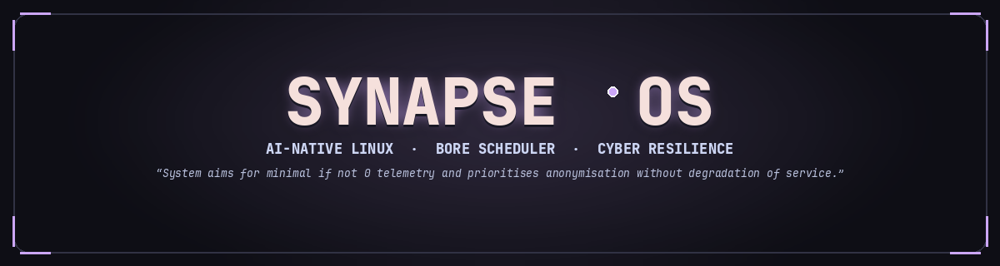

# SynapseOS

<p align="center">
  
</p>

> **An AI-Native Rolling Linux Distribution**  
> *Engineered for High-Throughput Agentic Development, Cyber Resilience, and Kernel Performance.*
>
> *"System aims for minimal if not 0 telemetry and prioritises anonymisation without degradation of service."*

```
 ░████  ██  ██ ███ ██  ░███  █████   ░████  ██████        ░████░   ░████ 
░██░░░  ░██░██ ░███░█ ░██░██ ░██░██ ░██░░░  ░██░░░       ░██░░██░ ░██░░░ 
░░███░   ░███░ ░██░██ ░█████ ░████░ ░░███░  ░████        ░██  ██░ ░░███░ 
  ░░██░   ░██░ ░██░██ ░██░██ ░██░░░   ░░██░ ░██░░░       ░██░░██░   ░░██░
░████░    ░██░ ░██ ░█ ░██ ░█ ░██    ░████░  ░█████        ░████░  ░████░ 
```

SynapseOS merges four powerful principles into one seamless operating system:

1. **CachyOS Performance**: Custom BORE / EEVDF CPU schedulers (`linux-cachyos`), `x86-64-v3` microarchitecture optimization, aggressive ZRAM `zstd` compression (`vm.swappiness=180`), TCP BBR, and `ananicy-cpp` process auto-nicing.
2. **EndeavourOS Foundation**: Clean, unbloated upstream Arch Linux rolling foundation, transparent packaging, Calamares installer with Btrfs `@` subvolume layouts, and native systemd management.
3. **Omarchy-style Cyberdeck Aesthetic**: Monospace terminal-first environment, the `synapseos` SDDM greeter (clock + system readout, animated accent-trail panel), 14 SynapseOS wallpaper/theme variants, Picom `dual_kawase` glass blur, Catppuccin Mocha accents, and instant Super-key command palettes (`llm-quickfire-panel`).
4. **Synapse AI Core**: Deeply built into the core OS package (`synapse-core`), providing a `127.0.0.1:8000` runtime proxy, bidirectional context firewall, 3-layer persistent agent memory, and local Ollama LLM routing out of the box.
5. **Prime Directive (Security, Anonymity & Zero Telemetry)**: Full MAC address randomization on scanning and per-session links, RFC 4941 IPv6 privacy extensions, encrypted Quad9 DNS-over-TLS (`9.9.9.9:853`), hardened zero-telemetry Chromium, and incoming-drop firewalld posture:
   > *"System aims for minimal if not 0 telemetry and prioritises anonymisation without degradation of service."*

---

## 📂 Repository Layout

```
synapseOS/
├── .agents/                 # Antigravity agent rules (Gemini 4 Argon configuration)
├── .github/workflows/       # CI/CD ISO build & Gate G1-G4 verification pipeline
│   └── build-iso.yml
├── .vscode/                 # Antigravity IDE workspace settings
├── docs/                    # Technical research, architecture & design whitepapers
│   ├── ARCHITECTURE.md
│   ├── RESEARCH_SYNAPSE_INTEGRATION.md
│   ├── INSPIRATIONS_ANALYSIS.md
│   └── GIT_REPO_STRATEGY.md
├── build/                   # Archiso live image profile & verification tooling
│   ├── archiso/             # Profiledef, package manifest, pacman.conf, bootloaders & airootfs
│   ├── build-iso.sh         # Automated ISO build & overlay staging script
│   └── verify-gates.sh      # Gate G1-G4 verification test harness
├── packages/                # Native Arch Linux PKGBUILD recipes & installer configs
│   ├── core/synapse-core/   # PKGBUILD for Synapse runtime gateway & systemd units
│   ├── desktop/             # llm-quickfire-panel, synapse-themes & synapse-greeter PKGBUILDs
│   └── installer/calamares/ # Calamares settings, Catppuccin branding & Btrfs modules
├── overlay/                 # Root filesystem overlays (/etc, sysctl, NetworkManager, skel)
├── tests/                   # Automated pytest verification suite
├── AGENTS.md                # System instructions & Prime Directive
├── GEMINI.md                # Gemini workspace settings
└── ROADMAP.md               # Completed Phase 1-5 implementation milestones
```

---

## 🚀 Quick Start (Verification & Building the ISO)

### 1. Clone the Repository
```bash
git clone git@github.com:earnerbaymalay/synapseOS.git
cd synapseOS
```

### 2. Run the Engineering Verification Gates (G1–G4)
Validate all `PKGBUILD` recipes (Gate G1), kernel/ZRAM/stealth network configs (Gate G2), Cyberdeck UI/Picom/SDDM handoff (Gate G3), and Archiso/Calamares installer integrity (Gate G4):
```bash
./build/verify-gates.sh
```

### 3. Validate ISO Staging in Non-Root Dry-Run Mode
Sync `overlay/` and Calamares configurations into `build/archiso/airootfs/etc` and verify Archiso readiness without requiring root privileges:
```bash
./build/build-iso.sh --dry-run
```

### 4. Build the Bootable SynapseOS Live ISO
On an Arch Linux / EndeavourOS host with `archiso` installed:
```bash
# Build native PKGBUILDs into the local [synapseos] repo and generate the ISO
./build/build-iso.sh --build-pkgs

# Or run mkarchiso directly via the wrapper (outputs to ./out/)
./build/build-iso.sh
```

### 5. Boot & Test in QEMU/KVM
```bash
qemu-system-x86_64 -m 4G -smp 4 -enable-kvm -cdrom out/synapseos-*.iso
```
