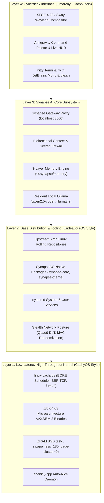

# SynapseOS System Architecture Specification

## 1. Vision & Core Philosophy

**SynapseOS** is an AI-native rolling Linux operating system engineered from the ground up for developers, security researchers, and AI-assisted workflows. It synthesizes four distinct paradigms:

```
┌────────────────────────────────────────────────────────────────────────┐
│                              SynapseOS                                 │
├──────────────────┬─────────────────┬──────────────────┬────────────────┤
│     CachyOS      │   EndeavourOS   │     Omarchy      │    Synapse     │
│   Performance    │  Arch Simplicity│ Cyber Aesthetic  │ AI Subsystem   │
├──────────────────┼─────────────────┼──────────────────┼────────────────┤
│ • BORE/EEVDF     │ • Minimal base  │ • Terminal-first │ • Runtime proxy│
│ • x86-64-v3/v4   │ • Arch Rolling  │ • Monospace HUD  │ • Context FW   │
│ • ZRAM zstd      │ • Pacman hooks  │ • Liquid chrome  │ • Agent memory │
│ • ananicy-cpp    │ • Transparent   │ • Catppuccin     │ • Local LLMs   │
└──────────────────┴─────────────────┴──────────────────┴────────────────┘
```

---

## 2. Layered Operating System Stack



---

## 3. Core System Subsystems

### A. Kernel & Microarchitecture Optimization (CachyOS Inspiration)
- **Kernel**: `linux-cachyos` or custom `linux-synapse` built with GCC/Clang with `-O3 -march=x86-64-v3` flags.
- **CPU Scheduling**: BORE (Burst-Oriented Response Enhancer) or EEVDF for zero-latency interactive shell responsiveness even when background compilation or LLM token generation runs at 100% CPU load.
- **Memory & Swap**: 8GB ZRAM compressed with `zstd`. Kernel sysctl parameters:
  - `vm.swappiness = 180`
  - `vm.page-cluster = 0`
  - `vm.vfs_cache_pressure = 50`
- **Networking**: `tcp_bbr` congestion control enabled by default.

### B. Minimalist Arch Foundation (EndeavourOS Inspiration)
- **Base**: Direct rolling synchronization with Arch Linux upstream package repositories.
- **Zero Bloat Policy**: No heavy background telemetry daemons, no unnecessary Flatpak runtimes pre-bundled, no hidden cron scripts.
- **Transparent Pacman Configuration**: Clean `/etc/pacman.conf` with dedicated `[synapseos]` repository overlay taking precedence for optimized binaries and AI packages.
- **Installation**: Modular Calamares installer supporting Btrfs with auto-snapshots, Ext4 with noatime, and ZFS.

### C. Cybernetic Terminal & Desktop Interface (Omarchy Inspiration)
- **Palette & Theme**: Unified Catppuccin Mocha Mauve + Liquid Chrome styling across terminals, GTK, icons, and SDDM.
- **Window Management**: XFCE 4.20 (customized with `Catppuccin-Mauve-Dark` and native Launchpad launcher) + optional Sway/Wayland tiling session.
- **Live HUD & Palette**: Standalone Super-key toggle (`xcape`) opening the searchable Antigravity/Synapse command palette with instant telemetry monitors.

### D. The Synapse AI Subsystem
- **Core Binary**: `/usr/bin/synapse` built from Rust sources.
- **System Service**: Managed by systemd (`synapse.service`), exposing a secure loopback gateway with bearer tokens and DNS-rebinding protection.
- **Context Firewall**: Bidirectional inspection verifying that credentials, private keys, and high-entropy secrets are blocked *before* they leave the machine or touch disk.
- **Persistent Agent Memory**: Central storage at `/var/lib/synapse/memory` or `~/.synapse/memory`, with automated distillation to Obsidian.
