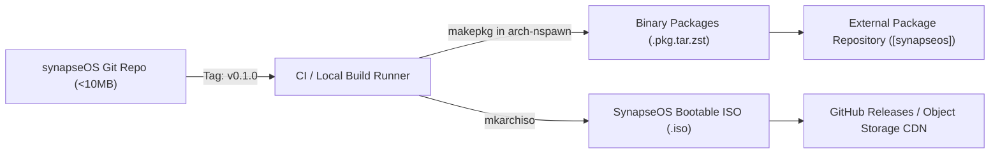

# Git Repository Strategy for Large-Scale OS Distribution Projects

Building a Linux distribution involves managing multiple distinct layers: upstream source code, package recipes, root filesystem overlays, installer images, and documentation. If not structured properly, OS git repositories quickly swell into gigabytes of bloated history.

This document outlines the **Clean Git Architecture** for SynapseOS.

---

## 1. The Core Anti-Patterns in OS Repositories

1. **Tracking Binary ISOs or RootFS Tarballs in Git**:
   - Committing a 2GB `.iso` file or `rootfs.tar.gz` permanently bloats `.git/objects` forever, making `git clone` painful for all contributors.
2. **Monorepo Bloat with External Upstream Dependencies**:
   - Inlining huge third-party software trees directly into git commits rather than maintaining clean package recipes (`PKGBUILD`).
3. **Tracking Machine-Local Build States**:
   - Committing chroot mount points, pacman package caches, or local GPG keys.

---

## 2. The Clean Repository Structure

SynapseOS strictly adopts the **Metadata-as-Code** pattern used by Arch Linux, Debian, and Fedora:

```
synapseOS/
├── .agents/                    # Antigravity / Gemini 4 Argon agent rules & skills
│   └── rules/
├── .vscode/                    # Antigravity IDE workspace configuration
├── docs/                       # Architecture, research papers, specifications
│   ├── ARCHITECTURE.md
│   ├── RESEARCH_SYNAPSE_INTEGRATION.md
│   ├── INSPIRATIONS_ANALYSIS.md
│   └── GIT_REPO_STRATEGY.md
├── build/                      # Build orchestration (Code only, no artifacts)
│   ├── archiso/                # archiso profile (profiledef.sh, packages.x86_64)
│   └── scripts/                # Automated chroot & ISO generation scripts
├── packages/                   # Native Arch PKGBUILD recipes
│   ├── core/
│   │   ├── synapse-core/       # PKGBUILD building Synapse daemon from git
│   │   ├── synapse-firewall/   # nftables/systemd context firewall rules
│   │   └── synapse-desktop/    # Theme, icons, and SDDM greeter
│   └── aur/                    # Custom AUR package recipes
├── overlay/                    # System root overlay (/etc, /usr/share skeleton)
│   ├── etc/
│   │   ├── synapse/
│   │   ├── sysctl.d/
│   │   └── systemd/
│   └── skel/                   # Default user profile dotfiles
├── AGENTS.md                   # Agent Prime Directive & guidelines
├── GEMINI.md                   # Gemini workspace rules
├── README.md                   # Distribution overview & getting started
└── ROADMAP.md                  # Milestone tracking
```

---

## 3. Git Release & Artifact Pipeline

To keep the repository featherlight (< 10 MB total size):



- **Git Tracks Only Source & Metadata**: PKGBUILD recipes, systemd unit files, config templates, and documentation.
- **Binaries Live in the Package Repository**: Built `.pkg.tar.zst` packages are pushed to a signed Pacman repository, never into Git.
- **ISOs Live in Release Assets**: Built ISO images are uploaded to GitHub Release assets or an S3/Cloudflare R2 bucket with SHA256 checksums.

---

## 4. Branching & Contribution Model

- `main`: Production-ready, verified package recipes and ISO profile definitions.
- `staging`: Integration branch where package updates are tested in chroots before promoting to main.
- `feat/*`: Topic branches for specific subsystems (e.g. `feat/cachy-kernel-hook`, `feat/synapse-daemon-preset`).
- **Commit Standards**: Conventional Commits (`feat(kernel):`, `fix(sddm):`, `docs(arch):`) to enable automated changelog generation and semantic release tagging.
